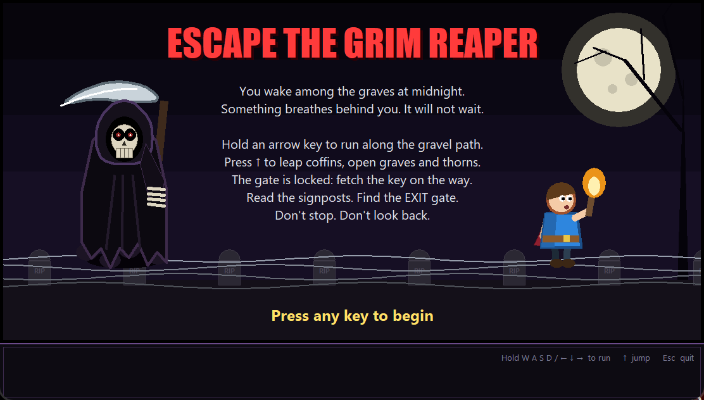

# Escape the Grim Reaper

A short, tense escape game you start from your terminal.

You wake up at midnight in a fenced graveyard holding a torch, and the Grim Reaper is right behind you. A gravel path winds between the rows of graves to the gate. Run it, leap everything lying across it, and get out before its hand closes on your shoulder.



- **A path through the graves.** The whole graveyard is on screen. A pale gravel path runs in four lanes between neat rows of headstones, from where you stand to the EXIT gate in the south fence.
- **Hold to run.** Hold an arrow key (or W A S D) and you keep running, with no pause between steps. Press the next direction a moment before a bend and you take the corner as soon as it opens.
- **Leap or fall.** Coffins and fallen headstones block the path, and open graves and thorn bushes lie across it. Press **↑** to leap them. Run into a coffin and you stop; run into an open grave or thorns and you lose a life. An ↑ pressed a moment early still counts.
- **It doesn't wait.** The Reaper sets off at your first step and glides after you on its own, a little slower than you run. Stop, hesitate, or take a wrong turn, and it closes in. The hearts beat faster and the frame glows red when it's right behind you.
- **The gate is locked.** Fetch the golden key from the little yard at the second bend first. Going in and out means running toward the Reaper for a moment, so don't arrive there with it on your heels.
- **Short way or safe way.** Near the end, a gap leads straight down past a thorn bush: leap it and you save almost a second. Miss, and it costs a life. The long way round has no hazards.
- **Don't stop.** Stand still, or keep bumping into things, and the Reaper surges to your running speed ("The Reaper quickens!"). Run on for a second and it calms down.
- **Beat your best.** The game keeps your best time in a small file in your home folder (`~/.escape_grim_reaper.json`) and shows **NEW BEST!** when you beat it.
- **Read the signposts.** Red signposts warn about side paths that are dead ends (*"Wanna get stuck?"*). Green ones point the way, to the key, and to the shortcut.
- **Three lives.** Three red hearts show your lives. When the Reaper catches you or a hazard hurts you, a heart turns grey and empty, and **R** puts you back at the start. Lose all three and it's **GAME OVER**.


## Requirements

Python 3.10 or newer. Nothing else to install to play: graphics use tkinter, which comes with Python. The game is silent. The only file it writes is your best time.

## Run the game

```
py -m escape_game
```

| Key | Action |
|---|---|
| Arrow keys ← ↓ → or W A S D (hold) | run; W runs north |
| ↑ | leap over the coffin, headstone, open grave or thorns in front of you |
| R | resume after you lose a life (you and the Reaper go back to the start); play again after GAME OVER |
| Esc | quit |

Options:

| Option | Effect |
|---|---|
| `--text` | play inside the terminal instead of a window. This version is turn-based: type `w`/`a`/`s`/`d` + Enter to move, `j` + Enter to jump, `r` + Enter to resume, `q` to quit. The Reaper takes one step after each of yours. You still need the key (`K`); there is no surge and no saved best time. |
| `--no-color` | with `--text`: plain text for terminals without colour support |

## Run the tests

```
py -m pip install pytest   # once
py -m pytest
```

Every test is named after the requirement it checks (`test_R1_...` to `test_R18_...`). The window tests open hidden tkinter windows and let time pass by hand. See `problem.md` for the requirements, `spec.md` for how the game meets them, and `docs/decisions/` for the decisions behind it.

## Project layout

```
escape_game/
  __main__.py   command-line entry point (window by default, --text for terminal)
  maze.py       the fixed graveyard: the path, obstacles, hazards, signposts, routes
  game.py       the rules: moves and jumps, the real-time chase clock, lives, win/lose
  gui.py        the game window: the graveyard (drawn once), moving figures, HUD, screens
  render.py     the terminal (--text) version's drawing
  records.py    the best time, kept in ~/.escape_grim_reaper.json
tests/          pytest tests, one or more per requirement
docs/           screenshots and decision records (docs/decisions/)
```
