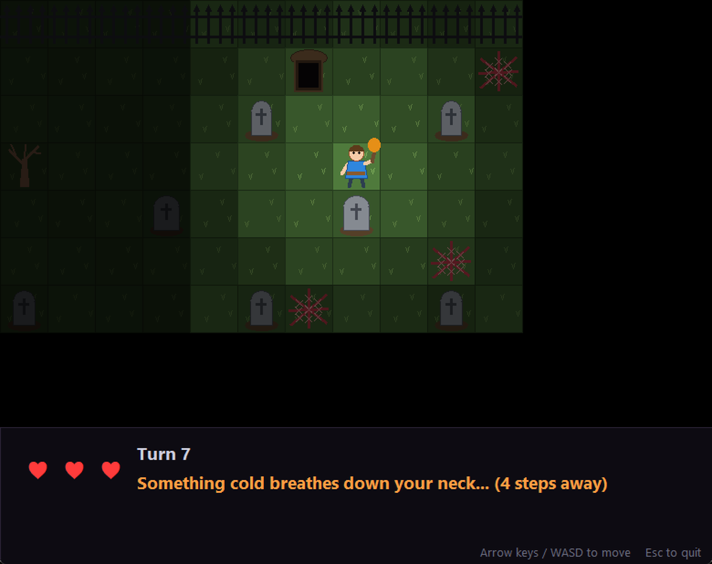

# Escape the Grim Reaper

A short, tense escape game you start from your terminal.

You wake up at midnight in a fenced graveyard holding a torch, and the Grim Reaper is four steps behind you. Every move you make, it makes one too. Find the exit gate before its hand closes on your shoulder.


- **The graveyard is dark.** Your torch lights only the few tiles around you. Everything else is black.
- **Graves block, hazards hurt.** Gravestones, iron fences and dead trees stand in your way. **Open graves** and **thorn bushes** cost you a life if you step on them, and the Reaper glides straight over them.
- **Read the signposts.** Red signposts warn you away from fenced plots that are dead ends (*"Wanna get stuck?"*). Green signposts point toward the gate. Walk to the back of a plot and the Reaper has you.
- **Feel it coming.** A heartbeat sounds every turn and gets faster and higher as the Reaper closes in. The heart on screen pulses faster, and the screen flashes red when it's right behind you.
- **Three lives.** Three red hearts show your lives. When the Reaper catches you or a hazard hurts you, a heart turns grey and empty, and you press **R** to start again from the graveyard's entrance. Lose all three and it's **GAME OVER**.



## Requirements

- Python 3.10 or newer. Nothing else to install to play: graphics use tkinter, which comes with Python.
- Sound uses `winsound` on Windows. Other systems get the terminal bell.

## Run the game

```
py -m escape_game
```

| Key | Action |
|---|---|
| Arrow keys or W A S D | move one tile (one keypress = one turn) |
| R | resume after you lose a life (you and the Reaper go back to the start); play again after GAME OVER |
| Esc | quit |

Bumping into a gravestone, fence or tree doesn't cost you a turn.

Options:

| Option | Effect |
|---|---|
| `--mute` | play without sound |
| `--text` | play inside the terminal instead of a window (type `w`/`a`/`s`/`d` + Enter, `r` + Enter to resume after losing a life, `q` to quit) |
| `--no-color` | with `--text`: plain text for terminals without colour support |

## Run the tests

```
py -m pip install pytest   # once
py -m pytest
```

Every test is named after the requirement it checks (`test_R1_...` to `test_R7_...`). The window tests open hidden tkinter windows and never play sound. See `problem.md` for the requirements and `spec.md` for how the game meets them.

## Project layout

```
escape_game/
  __main__.py   command-line entry point (window by default, --text for terminal)
  maze.py       the fixed graveyard: obstacles, hazards, signposts, shortest-path search
  game.py       turn order, reaper chase, hazards, lives, win/lose rules
  gui.py        the game window: drawn figures, torch light, signs, HUD, screens
  render.py     the terminal (--text) version's drawing
  sound.py      heartbeat and win/lose tones
tests/          pytest tests, one or more per requirement
docs/           screenshots and decision records (docs/decisions/)
```
